# Guia completo de uso - Cloud Project PDV

**Versão documentada:** 0.1.47  
**Revisado em:** 2026-10-15

Este guia acompanha os nomes de menus da fonte 0.1.47. Recursos e permissões podem variar conforme licença, perfil e configuração do terminal. Siga as confirmações exibidas pelo sistema e confira os dados antes de salvar.

> Este manual descreve os fluxos e nomes encontrados na versão documentada. As opções podem variar conforme licença, perfil e configuração. Antes de confirmar operações que alteram dados, confira os valores apresentados na tela.

## Visão rápida do trabalho

1. Prepare a conta, a licença e o banco.
2. Cadastre produtos, pessoas, fornecedores e serviços.
3. Registre entradas e confira os saldos de estoque.
4. Abra o caixa quando necessário, registre vendas e acompanhe pagamentos.
5. Consulte relatórios e mantenha backups verificados.

## Capítulos

### 01. VISÃO GERAL - O fluxo completo de uma operação

O trabalho normalmente começa no cadastro, passa pela entrada e conferência do estoque e termina na venda, no recebimento e nos relatórios. O backup protege a base ao longo do processo.

**Passo a passo**

1. Cadastre a empresa, os usuários e os dados de produtos, clientes e fornecedores.
2. Registre compras e entradas para formar o saldo; confira custos, quantidades e lotes.
3. Abra o caixa quando a operação exigir e registre a venda pelo PDV.
4. Acompanhe vendas, pagamentos, estoque e relatórios; mantenha cópias de segurança recentes.

**Resultado esperado:** Cada etapa fica no módulo correspondente e pode depender de permissões e configurações do terminal.

**Atenção:** Antes de operar em produção, confirme a conexão e a estrutura do banco na tela Estado do banco, revise os usuários e faça um backup verificável.

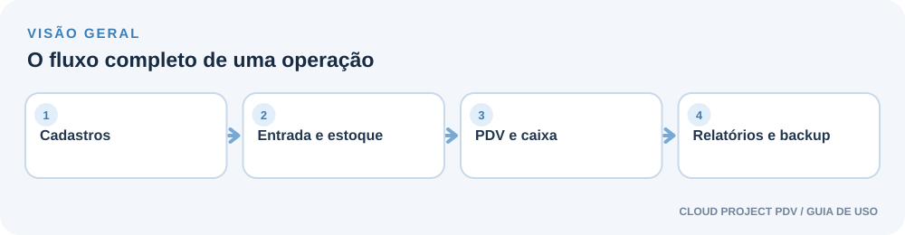

### 02. PRIMEIRO ACESSO - Entrar e preparar o terminal

O aplicativo libera as operações quando a conta, a licença, o Firebird e a estrutura do banco estão prontos.

**Passo a passo**

1. Entre com a conta criada para a instalação e defina uma senha forte quando a tela solicitar.
2. Em Registro do Sistema, confira as informações da licença e conclua o registro quando necessário.
3. Na tela Estado do banco, use Verificar novamente e confira conexão, servidor e versão do schema.
4. Quando o banco estiver pronto, cadastre ou revise a empresa, as contas de usuário e as permissões.

**Resultado esperado:** A tela de login leva ao sistema quando a autenticação e o estado do banco permitem operar.

**Atenção:** Se aparecer Banco indisponível, Estrutura pendente, Configuração necessária ou Recuperação necessária, use a orientação dessa tela e a área Backups e restauração. Não apague nem substitua arquivos do banco manualmente.

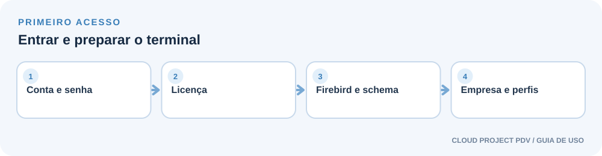

### 03. CADASTROS - Cadastrar produtos e pessoas

Cadastros corretos alimentam o estoque, o PDV, as ordens de serviço e os relatórios.

**Passo a passo**

1. Em Cadastros, escolha Produtos, Clientes, Fornecedores, Funcionários ou o registro necessário.
2. No produto, digite ou leia o código de barras para consultar dados disponíveis; confira cada campo sugerido.
3. Revise descrição, fabricante, unidade, preços, saldo inicial, pesos bruto e líquido e dimensões; complete o que faltar.
4. Inclua uma imagem que você tenha direito de usar, salve e localize o registro para conferir o resultado.

**Resultado esperado:** Produtos de Grade servem para organizar variações; setores, marcas, unidades e localizações ajudam a classificar os itens.

**Atenção:** Uma consulta de código de barras não garante foto, fabricante, peso ou dimensões. Confira a origem da informação e use o preenchimento manual quando necessário.

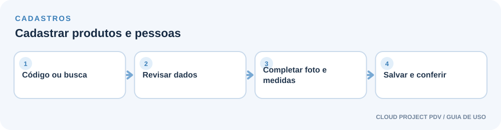

### 04. ESTOQUE - Registrar uma compra e receber mercadorias

A compra pode ser guardada como rascunho antes de efetivar o recebimento no estoque.

**Passo a passo**

1. Abra Estoque → Compras ou Nota de Entrada e inicie uma compra.
2. Informe o fornecedor, a data e a identificação do documento; adicione os produtos e quantidades.
3. Confira custos, totais e linhas. Use Salvar rascunho se ainda estiver conferindo.
4. Quando os dados estiverem corretos, use Receber e lançar estoque e confira a listagem de entrada.

**Resultado esperado:** A listagem de compras e entradas ajuda a localizar o documento e acompanhar seu estado.

**Atenção:** Receber e lançar estoque altera saldos. Confira fornecedor, itens, quantidades e documento antes de confirmar para evitar duplicidade de entrada.

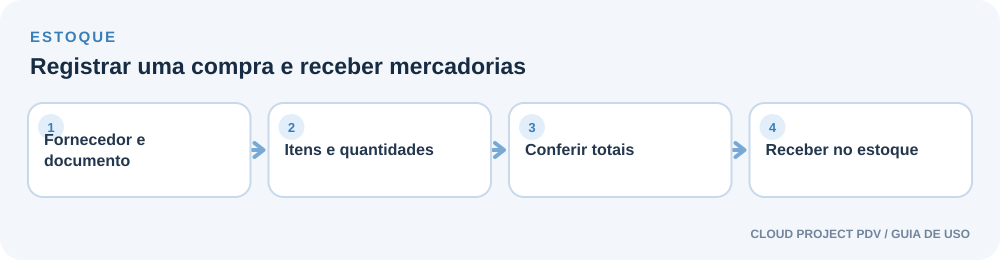

### 05. ESTOQUE - Consultar e controlar o estoque

Use as consultas e os registros de movimentação para entender saldo, custo, lotes e itens que precisam de atenção.

**Passo a passo**

1. Use Estoque → Gerenciar Estoque ou Consultar Preços para localizar um produto.
2. Registre notas de saída sem venda ou ajustes apenas com quantidade, motivo e referência conferidos.
3. Quando aplicável, controle lotes, validade e certificado de garantia no registro correspondente.
4. Use Inventário, Estoque Crítico e Patrimônio em Estoque para revisar diferenças e itens importantes.

**Resultado esperado:** Tabela de Preços e os relatórios de produtos ajudam a revisar preço de varejo, atacado e promoções.

**Atenção:** Ajustes e saídas podem reduzir ou aumentar o saldo. Confirme o item e o motivo antes de salvar; não use Nota de Saída [Sem Venda] para registrar uma venda comum.

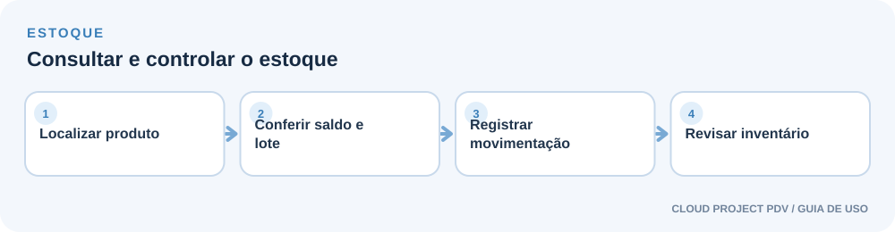

### 06. VENDAS - Fazer uma venda no PDV

O PDV localiza cada produto, mostra uma prévia breve e reúne os itens no carrinho antes do pagamento.

**Passo a passo**

1. Abra Vendas → Vender (PDV) e confira o status do caixa.
2. Leia o código de barras ou pesquise o item; confira descrição, preço e a imagem cadastrada quando disponível.
3. Revise os itens e quantidades no carrinho. Se necessário, selecione o cliente, aplique desconto autorizado ou corrija o item.
4. Informe forma e valor de pagamento, confira o total e finalize a venda; depois revise o comprovante oferecido.

**Resultado esperado:** No layout do PDV, a área Produtos desta venda reúne os itens adicionados; a prévia ajuda a confirmar o produto localizado.

**Atenção:** Atalhos exibidos na tela: F1 finalizar venda, F2 cancelar venda, F3 cancelar item, F4 sugerir quantidade e F5 pré-venda. Confira o item antes de concluir; o comprovante não fiscal não substitui documento fiscal.

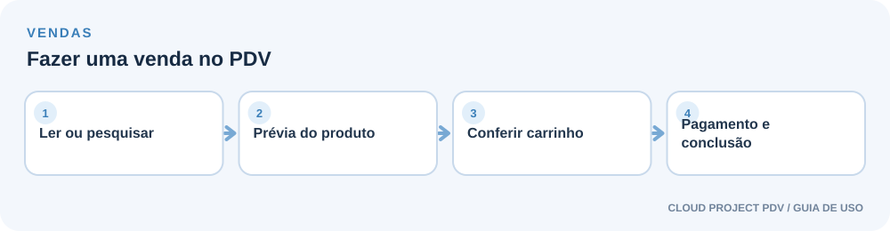

### 07. VENDAS - Salvar uma pré-venda e acompanhar vendas

A pré-venda guarda itens e preços para retomar no PDV. O acompanhamento de vendas, cancelamentos, devoluções e entregas fica nos módulos de vendas.

**Passo a passo**

1. Monte os itens no PDV e confira descrição, quantidade e preço.
2. Use Pré-venda (F5), informe a validade e uma observação se necessário, e salve.
3. Para consultar operações, abra Gerenciamento de Vendas, Listagem de Vendas ou Orçamentos.
4. Para devoluções e entregas, abra as listas correspondentes, localize o registro e confira as opções exibidas antes de confirmar.

**Resultado esperado:** Uma pré-venda salva pode ser retomada no PDV para continuar a operação.

**Atenção:** Salvar pré-venda não movimenta estoque, caixa ou contas. Cancelamento de venda e devolução são operações diferentes; leia o resumo e confirme os itens e valores corretos.

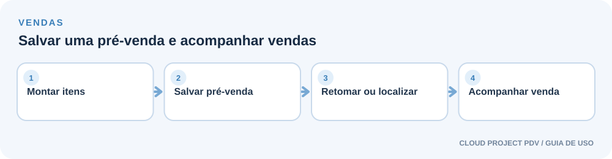

### 08. FINANCEIRO - Contas, recebimentos e caixas

O financeiro reúne compromissos e recebimentos. Caixa do Dia acompanha o turno de operação; Caixa da Empresa mantém um fluxo próprio de lançamentos.

**Passo a passo**

1. Use Contas a Pagar e Contas a Receber para consultar ou lançar compromissos e parcelas.
2. No Caixa do Dia, abra o caixa com o valor inicial, registre movimentações e confira o fechamento do turno.
3. Consulte Contas Pagas, Parcelas Apagadas, Recebimentos e Taxas de Cartões quando precisar localizar esses registros.
4. Em Caixa da Empresa, confira o fluxo e registre lançamentos próprios conforme a rotina financeira da empresa.

**Resultado esperado:** As telas de resumo ajudam a identificar vencimentos, recebimentos e movimentações do período.

**Atenção:** Caixa do Dia e Caixa da Empresa são áreas distintas. O livro da Caixa da Empresa não é sincronizado automaticamente com vendas, contas a pagar/receber ou adquirentes; confira os registros antes de usar como conciliação.

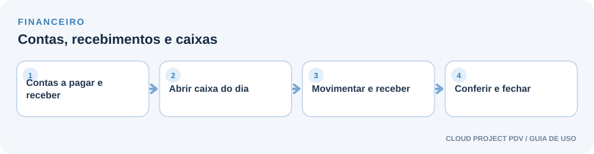

### 09. ORDEM DE SERVIÇO - Abrir e acompanhar uma ordem de serviço

Use a OS para registrar o atendimento técnico, serviços e itens relacionados ao equipamento ou produto do cliente.

**Passo a passo**

1. Abra Ordem de Serviço → Nova Ordem de Serviço e localize ou cadastre o cliente.
2. Descreva o equipamento, o problema informado e os serviços/itens necessários.
3. Confira os dados e salve a ordem; use Gerenciar Ordens de Serviços para localizá-la depois.
4. Atualize o andamento e as observações na própria OS; consulte os modelos de garantia disponíveis.

**Resultado esperado:** A listagem e o detalhe da OS ajudam a acompanhar histórico, situação e dados de atendimento.

**Atenção:** Confirme cliente, descrição e serviços antes de salvar. Um modelo de garantia só deve ser entregue depois de conferir seus dados e o prazo aplicável.

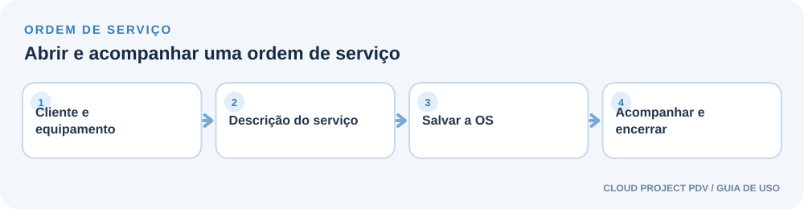

### 10. UTILITÁRIOS - Registrar um atendimento ao cliente

O módulo de Atendimento ao Cliente organiza solicitações e seu acompanhamento, separado da Ordem de Serviço.

**Passo a passo**

1. Em Utilitários → Atendimento ao Cliente, escolha Iniciar Novo Atendimento.
2. Localize o cliente e informe o responsável e a descrição necessária.
3. Revise e salve o registro; acompanhe a solicitação na Grade de Atendimentos.
4. Use os filtros Todos, Abertos ou Fechados e consulte o detalhe antes de alterar o estado.

**Resultado esperado:** A grade mantém os atendimentos localizáveis e permite consultar o andamento conforme o perfil.

**Atenção:** Registre apenas dados necessários ao atendimento e evite incluir senhas, dados de cartão ou outras informações secretas na descrição.

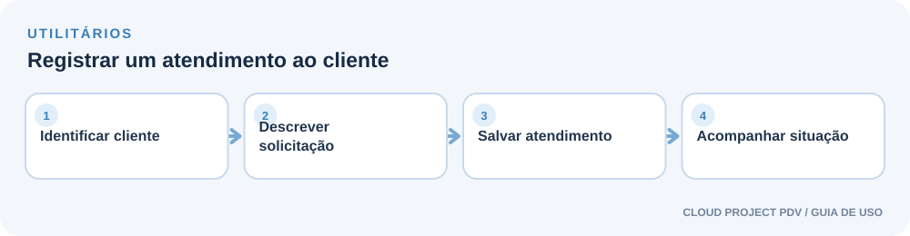

### 11. RELATÓRIOS E UTILITÁRIOS - Consultar relatórios e importar dados

Relatórios resumem cadastros, vendas e estoque. Importações devem ser conferidas antes de gravar dados.

**Passo a passo**

1. Abra Relatórios e escolha o assunto, como clientes, produtos, preços, promoções, estoque crítico ou inventário.
2. Informe o período ou os filtros disponíveis e confira a prévia antes de imprimir.
3. Para dados de produtos, use Utilitários → Importações / Exportações e selecione XML ou Excel.
4. Confira o arquivo, a prévia e o histórico de importação; use a exportação correspondente quando precisar gerar um arquivo.

**Resultado esperado:** A prévia ajuda a validar seleção, filtros e registros antes de imprimir ou importar.

**Atenção:** Importar pode criar ou alterar cadastros. Faça um backup, valide o arquivo e revise duplicidades e campos antes de confirmar.

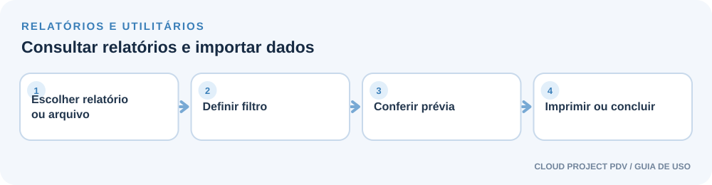

### 12. IMPRESSÃO - Configurar impressoras, modelos e etiquetas

O módulo oferece prévias para documentos A4 e comprovantes térmicos. A logo cadastrada da empresa pode compor os modelos compatíveis.

**Passo a passo**

1. Abra Configurações → Configurações Gerais → Impressão e confira as filas listadas pelo Windows.
2. Escolha papel, fila e modelo; os modelos térmicos incluem cinco opções: 80 mm Tipos 1, 2 e 3; 58 mm Tipos 1 e 2.
3. Para comprovantes, orçamentos, OS e relatórios em A4, abra Selecionar Modelo; confira a prévia e a opção de logo.
4. Em Estoque → Módulo Gerador de Etiquetas, selecione produtos, configure conteúdo/código, confira a prévia e imprima a calibração.

**Resultado esperado:** A seleção do modelo atualiza a prévia. A janela de modelos permite comparar alternativas antes de aplicar.

**Atenção:** A prévia ou a impressão de calibração abre o diálogo do navegador e não prova o resultado físico. Confira driver, papel, margens, escala e alinhamento; modelos térmicos são comprovantes não fiscais.

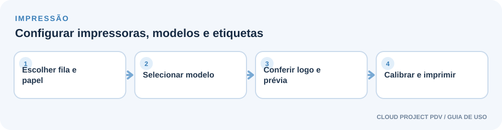

### 13. USUÁRIOS E SEGURANÇA - Gerenciar contas, permissões e sessões

Contas individuais permitem controlar acessos e entender quem realizou as ações registradas.

**Passo a passo**

1. Em Usuários → Cadastro de Usuários, crie uma conta individual e escolha o perfil adequado.
2. Use Perfil do Usuário e as permissões do terminal para limitar operações conforme a função.
3. Oriente cada pessoa a manter a senha privada e use Alterar Senha ou Trocar de Usuário quando necessário.
4. Administradores podem consultar Usuários Logados, Logs do Sistema e Histórico de Ações.

**Resultado esperado:** O indicador inferior mostra contas com atividade recente; a lista detalha sessões e dispositivos para administradores.

**Atenção:** Não compartilhe contas administrativas. Encerre sessões somente depois de conferir conta e dispositivo. Ative MFA para as contas administrativas antes de habilitar acesso externo.

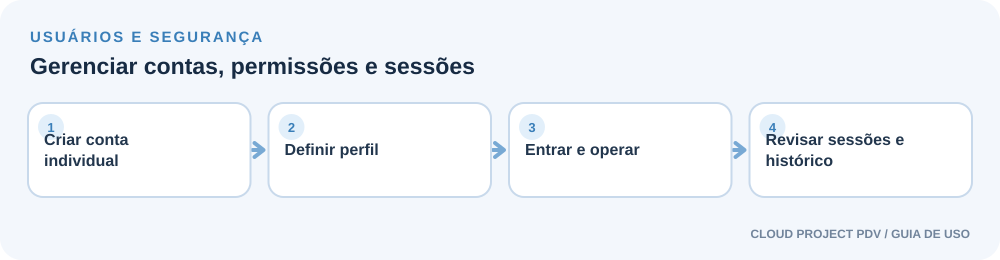

### 14. REDE E ACESSO MÓVEL - Acessar o sistema em outro dispositivo

Configurações de Rede controla o modo de acesso, o endereço e a proteção da conexão. A opção local só atende este computador.

**Passo a passo**

1. Abra Configurações → Configurações de Rede e escolha o modo compatível com a instalação.
2. Para acesso por celular, prepare HTTPS ou a VPN privada recomendada e confira o estado dos certificados.
3. Quando disponível, leia o QR Code para abrir o endereço HTTPS no celular.
4. Entre com uma conta autorizada e confirme MFA; teste o acesso de uma rede permitida.

**Resultado esperado:** O QR Code deve ser formado pelo endereço HTTPS atual do terminal; ele leva à página de login, não concede acesso sozinho.

**Atenção:** O acesso público permanece desligado por padrão. Ative senha forte e MFA nas contas administrativas antes de disponibilizar acesso externo. Se a pasta protegida de certificados não estiver preparada, siga a instalação administrativa fornecida para o terminal.

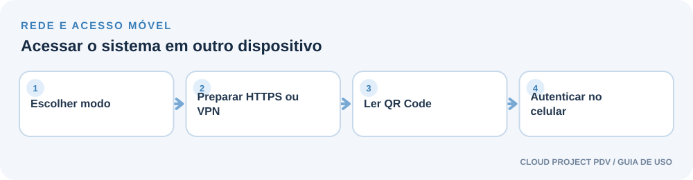

### 15. CÓPIA DE SEGURANÇA - Criar backups, restaurar e mudar de computador

Backups protegem o banco e permitem recuperar ou transferir a operação. Guarde o arquivo e a senha em locais protegidos.

**Passo a passo**

1. Abra Cópia de Segurança → Fazer Backup ou Backups e restauração e crie uma cópia criptografada.
2. Configure Backup Automático quando necessário e confira o horário e o status apresentados.
3. Antes de restaurar, verifique data, integridade e senha; crie outro backup do estado atual.
4. Para trocar de computador, siga Mudar de Computador e confirme cada etapa no terminal de origem e no destino.

**Resultado esperado:** A área de recuperação mostra ações para aplicar um backup ou voltar ao estado anterior quando uma restauração foi interrompida.

**Atenção:** Restaurar substitui o estado atual pelo conteúdo escolhido. Não feche o programa durante a restauração. Se surgir Recuperação necessária, abra Backups e restauração e siga a ação de recuperação indicada; peça apoio se o estado não estiver claro.

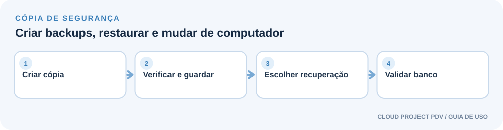

### 16. CONFIGURAÇÕES - Personalizar o terminal, o PDV e as telas

As configurações ajustam aparência, comportamento do PDV, terminal de preços, imagens e mensagens rotativas.

**Passo a passo**

1. Em Configurações Gerais, revise dados da empresa, identidade visual, impressões e preferências do terminal.
2. Em Configurações P.D.V, ajuste o comportamento e os conteúdos usados durante a venda.
3. Em Terminal de Preços, configure o tempo e as fotos; em Fotos do P.D.V, organize imagens de espera e mensagens configuráveis.
4. Salve, retorne ao terminal ou PDV e confira o resultado na tela que utiliza a configuração.

**Resultado esperado:** As preferências de impressão são compartilhadas neste computador; configurações de rede e algumas opções dependem do perfil administrador.

**Atenção:** Teste imagens em uma resolução adequada e confirme legibilidade e proporção na tela de destino. Uma alteração salva pode exigir atualizar a tela do PDV ou do terminal para aparecer.

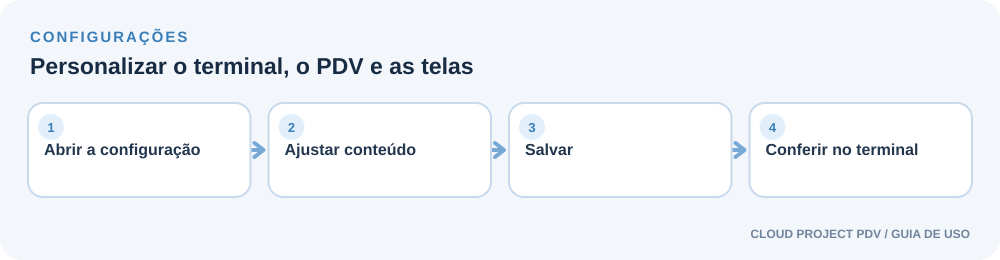

### 17. AJUDA E LICENÇA - Consultar a Ajuda, os termos e o registro

Use Ajuda para conhecer a versão e consultar orientações. O Registro do Sistema reúne informações e ativação da licença.

**Passo a passo**

1. Abra Ajuda → Guia de Uso para pesquisar por módulo ou palavra-chave.
2. Consulte Sobre para identificar o produto e Termos e Condições de Uso para abrir as informações disponíveis.
3. Em Registro do Sistema, confira informações da licença e o estado deste terminal.
4. Se a licença precisar de ativação, siga o fluxo oficial do emissor e preserve os dados locais.

**Resultado esperado:** A versão PDF deste guia também pode ser baixada pela Central de Ajuda.

**Atenção:** O guia não substitui o contrato comercial fornecido com a licença. Não compartilhe códigos de ativação, senhas ou arquivos de certificado em canais públicos.

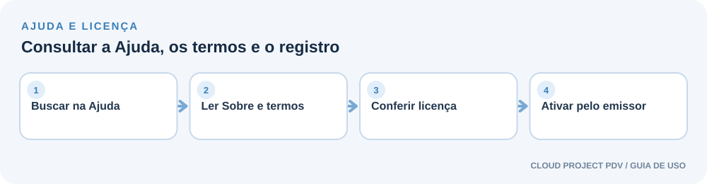

### 18. UTILITÁRIOS · STATUS - Editor SQL

**Status: EM IMPLANTAÇÃO**

Este módulo ainda está em implantação e não deve ser tratado como ferramenta disponível para operação.

**Passo a passo**

1. Não execute comandos SQL por esse módulo enquanto ele estiver identificado como Em implantação.
2. Para corrigir dados, use os módulos próprios do sistema ou abra um atendimento com o suporte.
3. Antes de qualquer manutenção assistida, confirme um backup íntegro e descreva o problema observado.
4. Consulte esta seção novamente quando a implantação e a documentação oficial do módulo forem concluídas.

**Resultado esperado:** O guia deixa explícito que o Editor SQL está em implantação e não documenta execução de consultas.

**Atenção:** Alterações manuais no banco podem danificar dados, licença, histórico e integridade. Não edite o banco diretamente.

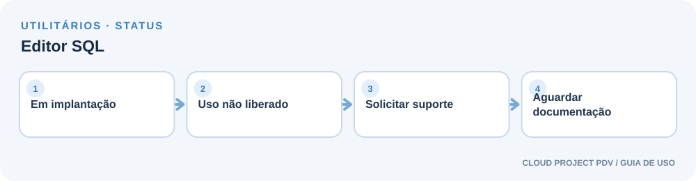

## Cuidados antes de operar

- Faça um backup antes de importações, restaurações e mudanças que afetem muitos registros.
- Não compartilhe senhas, códigos de licença, chaves MFA ou arquivos de certificado.
- Comprovantes térmicos descritos neste sistema são não fiscais; siga as obrigações fiscais aplicáveis ao negócio.
- Se a tela indicar banco indisponível ou recuperação necessária, siga o fluxo de recuperação e procure o suporte quando houver dúvida.
- O Editor SQL está em implantação e ainda não deve ser usado para operar ou alterar o banco.

## Ajuda e suporte

Abra Ajuda → Guia de Uso dentro do sistema. Para termos comerciais, consulte o contrato fornecido com a licença.
